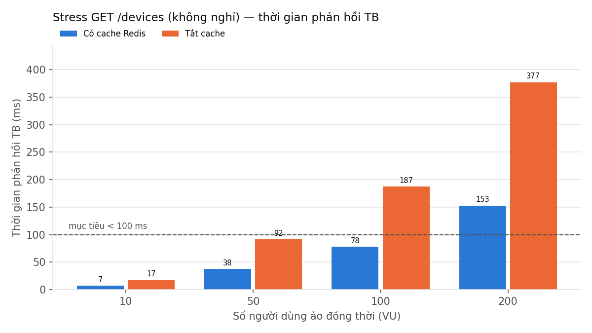
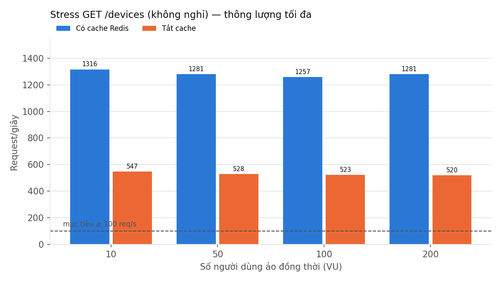
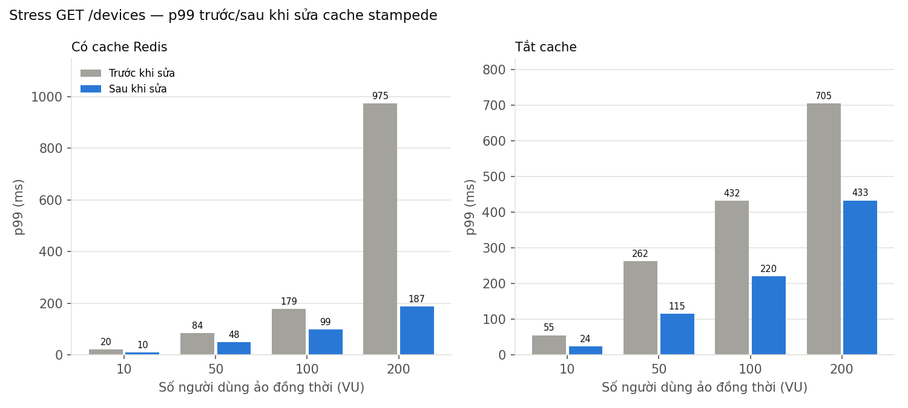
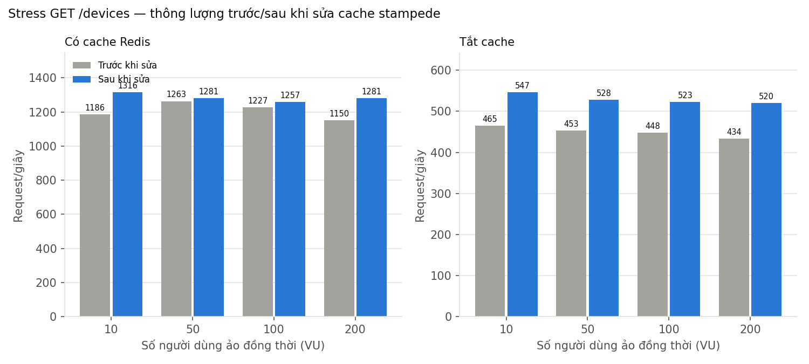

# Kết quả kiểm thử tải (k6) — TechRent backend

> Ngày chạy: 04/11/2026. Công cụ: **k6 v2.3.0**. Script: `load-tests/`. Số liệu gốc (summary JSON của k6): `docs/load-test/*-summary.json`. Biểu đồ: `docs/load-test/*.png`.
> Mục tiêu đối chiếu: mục 9 `TechRent-Roadmap.md` (Non-functional Requirements).
>
> **Cập nhật 04/11 (chiều)**: đã sửa lỗi 500 do *cache stampede* ở `GET /devices` (mục 5.1) và chạy lại 2 bài stress a3/b2 cùng cấu hình — phần stress của bảng 4.3 và 2 biểu đồ đầu là số liệu **sau khi sửa**; số liệu trước khi sửa giữ ở `docs/load-test/*-before-summary.json` và bảng so sánh ở mục 5.1. Các kịch bản a1, a2, b (tải thường), c, d **chưa chạy lại** — số liệu là của bản trước khi sửa.

## 1. Tóm tắt

| Mục tiêu (mục 9 Roadmap) | Kết quả đo | Đánh giá |
|---|---|---|
| Thời gian phản hồi API trung bình < 300 ms | Đọc dữ liệu: 2,4–23,3 ms ở mọi mức tải tới 200 người dùng ảo. Đặt thuê khi 100 người tranh **cùng 1 máy cùng 1 khung giờ**: 397 ms | **Đạt** với tải thực tế. Không đạt trong tình huống tranh chấp cực đoan (giải thích ở mục 4.4) |
| Danh sách thiết bị có cache Redis < 100 ms | TB 3,3 ms (p95 10 ms, p99 29 ms); bài stress không nghỉ: < 100 ms tới 100 người dùng ảo | **Đạt** |
| Chịu được ≥ 100 request/giây | 388 req/s ở 200 người dùng (có nghỉ 0,5 s); tối đa **~1.283 req/s** khi bắn liên tục (có cache, sau khi sửa stampede) | **Đạt** (gấp ~13 lần mục tiêu) |
| Tỷ lệ lỗi < 1% | 0,00% ở mọi kịch bản, kể cả 2 bài stress sau khi sửa (trước khi sửa: 113 lỗi 500 = 0,04% ở bài stress có cache) | **Đạt** |
| Không đặt trùng thiết bị | 5 vòng × 100 người: đúng 5 đơn thành công, 495 lần nhận 409, database 0 cặp đơn chồng lịch | **Đạt** |

## 2. Môi trường chạy

| Hạng mục | Cấu hình |
|---|---|
| Máy | ASUS TUF Gaming A15 FA507RC (laptop) |
| CPU | AMD Ryzen 7 6800H — 8 nhân / 16 luồng |
| RAM | 23,2 GB (trống ~9,9 GB lúc chạy) |
| Ổ cứng | SSD NVMe Kingston SNV3S 1 TB |
| Hệ điều hành | Windows 11 Home 10.0.26300 |
| Node.js | v20.19.0 |
| PostgreSQL 16 + Redis 7 | Docker Desktop 29.8.0 (WSL2, 16 CPU, ~11,3 GB RAM cấp cho Docker), cùng máy |
| Backend | **Bản build production**: `npm run build` rồi `node dist/main.js`, `NODE_ENV=production`, 1 tiến trình Node. Pool kết nối Postgres: 10 (mặc định của `pg`) ở lần đo đầu; **20** (`DATABASE_POOL_MAX`, mặc định mới) ở lần chạy lại a3/b2 sau khi sửa |
| k6 | Chạy **trên cùng máy** với backend + database (tranh CPU với nhau — xem mục 5) |
| Dữ liệu | Dữ liệu dev hiện có: 50 thiết bị / 16 danh mục, 169 đơn thuê |

**Cờ chỉ dùng khi kiểm thử** (mặc định không đặt → hệ thống giữ nguyên hành vi bình thường):

- `LOAD_TEST=true` — **tạm bỏ qua rate limit** (`skipIf` của `ThrottlerModule` trong `backend/src/auth/auth.module.ts`). Lý do: k6 bắn mọi request từ 1 địa chỉ IP, giới hạn mặc định 100 request/phút/IP sẽ chặn gần hết request công khai, làm số liệu phản ánh rate limit chứ không phải năng lực xử lý. **Khi chạy thật, rate limit vẫn bật** (100 request/phút/người dùng hoặc IP; đặt thuê 5 lần/phút/người dùng).
- `DEVICES_CACHE_DISABLED=true` (chỉ có tác dụng khi kèm `LOAD_TEST=true`) — tắt cache Redis của `GET /devices`, chỉ dùng cho kịch bản so sánh (b) (`backend/src/devices/devices-cache.service.ts`).
- `AI_ENABLED=false` — tắt Trợ lý AI để mô hình Ollama không chiếm CPU/GPU trong lúc đo (không ảnh hưởng các API được đo).

## 3. Kịch bản

| Mã | Kịch bản | Script | Tải |
|---|---|---|---|
| a1 | `GET /devices` (danh sách, có cache) — 4 tổ hợp lọc/sắp xếp/trang giống trang `/devices` | `devices-ramp.js` | 10 → 50 → 100 → 200 người dùng ảo (VU), mỗi mức 1 phút, nghỉ 0,5 s giữa 2 request |
| a2 | `GET /devices/:id` (chi tiết, ngẫu nhiên 50 máy) | `devices-ramp.js` | như a1 |
| b | `GET /devices` **tắt cache** | `devices-ramp.js` | như a1 |
| a3 / b2 | Stress `GET /devices` có cache / tắt cache — **không nghỉ** giữa các request, để tìm thông lượng tối đa | `devices-ramp.js` (`SLEEP=0`) | như a1 |
| c | Luồng hỗn hợp giống người dùng thật: xem danh sách → xem chi tiết → kiểm tra lịch trống → xem chính sách thuê (toàn bộ là đọc), nghỉ 1–2 s mỗi bước | `mixed-flow.js` | như a1 |
| d | Đặt thuê đồng thời: 100 tài khoản test (đủ CCCD + eKYC) cùng `POST /bookings` 1 thiết bị, cùng 1 khung giờ, cùng lúc; lặp 5 vòng (5 khung giờ khác nhau) | `booking-race.js` + `verify-race.js` | 100 VU × 5 vòng |

"Request/giây" theo từng mức = số request trong mức đó ÷ 60 giây.

## 4. Kết quả chi tiết

### 4.1. (a1) `GET /devices` — có cache Redis

| Mức tải | Số request | Request/giây | TB (ms) | Trung vị (ms) | p95 (ms) | p99 (ms) | Max (ms) | Lỗi |
|---|---:|---:|---:|---:|---:|---:|---:|---:|
| 10 VU | 1.145 | 19,1 | 2,8 | 2,3 | 5,3 | 14,5 | 24,6 | 0,00% |
| 50 VU | 5.779 | 96,3 | 2,5 | 2,0 | 5,8 | 12,3 | 29,6 | 0,00% |
| 100 VU | 11.685 | 194,8 | 2,4 | 1,9 | 5,6 | 13,1 | 82,9 | 0,00% |
| 200 VU | 23.302 | 388,4 | 4,0 | 2,0 | 14,4 | 39,6 | 217,0 | 0,00% |
| **Toàn bộ** | 41.912 | 174,2 | **3,3** | 2,0 | **10,0** | **28,9** | 217,0 | **0,00%** |

→ **Đạt** mục tiêu < 100 ms với biên độ rất lớn.

### 4.2. (a2) `GET /devices/:id` — chi tiết thiết bị (không cache)

| Mức tải | Số request | Request/giây | TB (ms) | Trung vị (ms) | p95 (ms) | p99 (ms) | Max (ms) | Lỗi |
|---|---:|---:|---:|---:|---:|---:|---:|---:|
| 10 VU | 1.135 | 18,9 | 5,1 | 3,7 | 8,4 | 38,3 | 56,1 | 0,00% |
| 50 VU | 5.770 | 96,2 | 3,7 | 3,2 | 6,2 | 17,8 | 92,9 | 0,00% |
| 100 VU | 11.619 | 193,7 | 4,3 | 3,3 | 10,8 | 23,8 | 40,0 | 0,00% |
| 200 VU | 23.308 | 388,5 | 4,8 | 3,2 | 13,9 | 27,3 | 70,9 | 0,00% |
| **Toàn bộ** | 41.833 | 174,0 | **4,5** | 3,2 | **12,3** | **25,6** | 92,9 | **0,00%** |

→ **Đạt** mục tiêu API < 300 ms. Truy vấn 1 thiết bị theo khoá chính rất nhẹ nên dù không cache vẫn nhanh.

### 4.3. (b) So sánh có cache / tắt cache cho `GET /devices`

**Tải thường** (nghỉ 0,5 s, cùng kịch bản với a1):

| Mức tải | Có cache: TB / p95 (ms) | Tắt cache: TB / p95 (ms) | Request/giây (có / tắt) |
|---|---:|---:|---:|
| 10 VU | 2,8 / 5,3 | 8,6 / 17,3 | 19,1 / 18,8 |
| 50 VU | 2,5 / 5,8 | 7,8 / 17,5 | 96,3 / 95,3 |
| 100 VU | 2,4 / 5,6 | 8,8 / 22,9 | 194,8 / 192,3 |
| 200 VU | 4,0 / 14,4 | 35,6 / 155,2 | 388,4 / 366,1 |
| **Toàn bộ** | **3,3 / 10,0** | **23,3 / 128,4** | 174,2 / 167,7 |

**Stress — không nghỉ** (a3 có cache, b2 tắt cache) — **sau khi sửa cache stampede** (số liệu trước khi sửa ở mục 5.1):

| Mức tải | Có cache: req/s | Có cache: TB / p95 / p99 (ms) | Tắt cache: req/s | Tắt cache: TB / p95 / p99 (ms) |
|---|---:|---:|---:|---:|
| 10 VU | 1.316,2 | 7,2 / 8,6 / 9,9 | 546,9 | 17,4 / 20,0 / 23,5 |
| 50 VU | 1.280,6 | 37,7 / 45,0 / 48,2 | 527,7 | 91,6 / 107,3 / 115,4 |
| 100 VU | 1.257,1 | 77,9 / 91,0 / 98,5 | 523,4 | 187,2 / 208,6 / 220,3 |
| 200 VU | 1.280,8 | 153,0 / 171,5 / 187,0 | 519,8 | 377,3 / 408,9 / 432,6 |
| **Toàn bộ** | **1.282,7** | 68,5 / 159,4 / 173,8 | **528,8** | 166,2 / 395,0 / 410,9 |
| Lỗi | 0,00% (0 / 308.087) | | 0,00% (0 / 127.066) | |





**Nhận xét:**

- Ở tải thường, cache giúp thời gian trung bình giảm **~86%** (23,3 → 3,3 ms) và p95 giảm **~92%** (128,4 → 10,0 ms). Khác biệt lộ rõ ở 200 VU: không cache thì p95 vọt lên 155 ms vì các truy vấn bắt đầu phải xếp hàng chờ kết nối database.
- Ở bài stress (sau khi sửa), cache tăng **thông lượng tối đa ~2,4 lần** (529 → 1.283 req/s) và giảm thời gian trung bình ~59% (166,2 → 68,5 ms).
- Trong bài stress, thông lượng gần như **không tăng thêm** từ 10 VU trở lên (có cache ~1.280 req/s, không cache ~525 req/s): hệ thống đã chạm giới hạn ngay từ 10 VU, thêm người dùng chỉ làm request xếp hàng lâu hơn — thời gian chờ tăng gần tỷ lệ thuận với số VU (đúng định luật Little: 200 VU ÷ 1.281 req/s ≈ 156 ms, khớp TB đo được 153 ms). Giới hạn khi có cache nhiều khả năng là CPU của **1 tiến trình Node** (đọc chuỗi JSON từ Redis rồi gửi về) cộng với việc k6 chạy chung máy; khi không cache là database (mỗi request chạy 2 truy vấn `findMany` + `count`). Lần chạy này chưa đo CPU từng tiến trình nên đây là nhận định, chưa phải kết luận đã kiểm chứng.

### 4.4. (c) Luồng hỗn hợp giống người dùng thật

| Mức tải | Số request | Request/giây | TB (ms) | Trung vị (ms) | p95 (ms) | p99 (ms) | Max (ms) | Lỗi |
|---|---:|---:|---:|---:|---:|---:|---:|---:|
| 10 VU | 396 | 6,6 | 3,4 | 2,8 | 8,6 | 18,5 | 61,3 | 0,00% |
| 50 VU | 2.000 | 33,3 | 2,5 | 2,5 | 4,5 | 9,7 | 24,0 | 0,00% |
| 100 VU | 4.020 | 67,0 | 2,4 | 2,3 | 5,0 | 12,2 | 52,5 | 0,00% |
| 200 VU | 8.012 | 133,5 | 2,3 | 2,0 | 4,8 | 14,8 | 79,9 | 0,00% |
| **Toàn bộ** | 14.429 | 58,5 | **2,4** | 2,1 | **4,9** | **13,9** | 79,9 | **0,00%** |

Theo từng bước:

| Bước | API | TB (ms) | p95 (ms) | p99 (ms) | Lỗi |
|---|---|---:|---:|---:|---:|
| Xem danh sách | `GET /devices` | 2,6 | 5,2 | 16,7 | 0,00% |
| Xem chi tiết | `GET /devices/:id` | 3,3 | 6,1 | 15,3 | 0,00% |
| Kiểm tra lịch trống | `GET /bookings/availability` | 2,7 | 4,5 | 13,5 | 0,00% |
| Xem chính sách | `GET /policies/rental` | 0,9 | 2,5 | 9,0 | 0,00% |

→ **Đạt** mọi mục tiêu. Mỗi người dùng ảo nghỉ 1–2 giây giữa các bước như người thật đọc trang, nên 200 người dùng đồng thời chỉ tạo ~134 req/s — hệ thống còn dư nhiều năng lực (xem bài stress ở 4.3).

### 4.5. (d) Đặt thuê đồng thời

100 tài khoản test (tạo bằng `load-tests/seed-users.js`, đã có CCCD + đủ 3 ảnh eKYC dạng `public_id` giả để qua kiểm tra nghiệp vụ) cùng gửi `POST /bookings` cho **1 thiết bị, 1 khung giờ** tại cùng 1 thời điểm; lặp 5 vòng với 5 khung giờ khác nhau.

| Vòng | Thành công (201) | Bị từ chối (409) | Lỗi khác | TB (ms) | Max (ms) |
|---|---:|---:|---:|---:|---:|
| 1 | 1 | 99 | 0 | 453,8 | 652,9 |
| 2 | 1 | 99 | 0 | 446,2 | 620,5 |
| 3 | 1 | 99 | 0 | 307,8 | 479,6 |
| 4 | 1 | 99 | 0 | 305,5 | 463,4 |
| 5 | 1 | 99 | 0 | 470,7 | 651,8 |
| **Tổng** | **5** | **495** | **0** | **396,8** (trung vị 393,4; p95 616,0; p99 645,3) | 652,9 |

Kiểm tra database ngay sau khi chạy (`load-tests/verify-race.js`): mỗi khung giờ có **đúng 1 đơn** (`pending`), và trên toàn bộ database có **0 cặp đơn chồng lịch** trên cùng thiết bị.

**Nhận xét:**

- **Tính đúng đắn: Đạt tuyệt đối** — cơ chế transaction + `SELECT … FOR UPDATE` + Exclusion Constraint (mục 5 Roadmap) giữ đúng "chỉ 1 người thắng" kể cả khi 100 request đến cùng lúc; 99 người còn lại nhận 409 với thông báo rõ ràng, không có lỗi 500 nào.
- **Thời gian phản hồi TB 397 ms — vượt mục tiêu 300 ms.** Đây là hệ quả có chủ đích của thiết kế: khoá dòng thiết bị buộc 100 request **xử lý lần lượt** (mỗi transaction chỉ vài ms, nhưng request thứ 100 phải chờ 99 request trước), cộng thêm pool chỉ 10 kết nối database. Tình huống 100 người cùng giành 1 máy cùng 1 khung giờ trong cùng 1 giây gần như không xảy ra trong thực tế cửa hàng cho thuê; đánh đổi "chậm hơn một chút khi tranh chấp" để "không bao giờ đặt trùng" là đúng ưu tiên. Ngoài ra rate limit thật (5 lần đặt/phút/người dùng) vẫn hoạt động khi chạy thật.

## 5. Phát hiện và hạn chế

### 5.1. Lỗi 500 khi cache hết hạn dưới tải cực cao — ĐÃ SỬA

**Lần đo đầu**: trong bài stress có cache ở mức 200 VU (~1.150 req/s), **113 request (0,04% tổng, 0,16% ở mức 200 VU)** trả lỗi 500. Log server: toàn bộ là `Transaction API error: Unable to start a transaction in the given time`.

**Nguyên nhân**: mọi key cache danh sách có cùng thời hạn 45 giây nên **hết hạn gần như cùng lúc**; ngay sau đó hàng trăm request đồng thời cùng "trượt cache" và cùng mở `$transaction([findMany, count])` (*cache stampede*), trong khi pool chỉ có 10 kết nối → các request chờ quá hạn 2 giây mặc định của Prisma bị huỷ.

**Cách sửa** (`backend/src/devices/devices-cache.service.ts`, `devices.service.ts`, `prisma/prisma.service.ts`):

1. **Single-flight**: `DevicesCacheService.getOrLoad(key, loader)` giữ 1 map "truy vấn đang chạy" theo cache key — các request trượt cache cùng key trong cùng tiến trình **dùng chung 1 lần truy vấn DB**. Lỗi truy vấn trả về cho mọi request đang chờ và không lưu vào cache. `invalidateAll()` bỏ các truy vấn đang chạy và tăng "thế hệ" cache: request đến sau khi xoá cache không nhập vào truy vấn cũ, kết quả truy vấn cũ (có thể đọc dữ liệu trước thay đổi) không được ghi vào cache → giữ nguyên hành vi xoá cache khi thiết bị thay đổi.
2. **TTL lệch ngẫu nhiên** 45 ± 10 giây (35–55 s) cho mỗi key, để các tổ hợp lọc không hết hạn cùng lúc.
3. **Bỏ `$transaction`** cho cặp `findMany` + `count` (chạy song song bằng `Promise.all`): đây là truy vấn chỉ đọc, lệch 1 bản ghi giữa danh sách và tổng số khi có thiết bị vừa thêm/xoá là chấp nhận được, còn transaction giữ 1 kết nối suốt 2 truy vấn và có hạn chờ 2 s (chính là nguồn lỗi).
4. **Pool Postgres 10 → 20** (env `DATABASE_POOL_MAX`, mặc định 20): 10 kết nối là nút thắt khi không có cache và khi nhiều người cùng đặt thuê; 20 vẫn chừa nhiều chỗ trong giới hạn mặc định 100 kết nối của PostgreSQL cho dev server, e2e test và công cụ quản trị chạy cùng lúc. Không tăng cao hơn vì backend chỉ có 1 tiến trình Node — nhiều kết nối hơn chỉ dời hàng đợi sang Postgres.

**So sánh trước / sau** (cùng kịch bản `devices-ramp.js`, `SLEEP=0`, 10 → 50 → 100 → 200 VU mỗi mức 1 phút, cùng máy):

| Bài | | Request/giây | TB (ms) | p95 (ms) | p99 (ms) | Max (ms) | Lỗi 500 |
|---|---|---:|---:|---:|---:|---:|---:|
| Có cache (a3) | Trước | 1.205,4 | 72,9 | 167,3 | 285,6 | 2.439,1 | **113** (0,04%) |
| | **Sau** | **1.282,7** | **68,5** | **159,4** | **173,8** | **589,8** | **0** |
| Có cache — riêng 200 VU | Trước | 1.150,0 | 170,4 | 267,6 | 974,9 | 2.439,1 | 113 (0,16%) |
| | **Sau** | **1.280,8** | **153,0** | **171,5** | **187,0** | **589,8** | **0** |
| Tắt cache (b2) | Trước | 449,1 | 195,6 | 554,0 | 649,9 | 818,5 | 0 |
| | **Sau** | **528,8** | **166,2** | **395,0** | **410,9** | **523,7** | **0** |





**Nhận xét:**

- Có cache: **hết hoàn toàn lỗi 500** (113 → 0), p99 toàn bài giảm ~39% (285,6 → 173,8 ms), riêng mức 200 VU p99 giảm ~81% (974,9 → 187,0 ms) và thời gian tối đa giảm từ 2,4 s xuống 0,59 s — các "gai" lúc cache hết hạn đồng loạt đã biến mất. Thông lượng tăng ~6% (1.205 → 1.283 req/s).
- Tắt cache: không có stampede nên thay đổi đến từ bỏ transaction + pool 20: thông lượng tăng ~18% (449 → 529 req/s), p95 giảm ~29% (554 → 395 ms).
- Hai lần đo không cùng thời điểm và tải nền (laptop, k6 chạy chung máy) nên chênh lệch vài phần trăm về thông lượng nằm trong sai số; kết luận chắc chắn là lỗi 500 và phần đuôi p99/max.
- Single-flight chỉ gộp request **trong 1 tiến trình Node**. Nếu sau này chạy nhiều tiến trình (cluster/PM2), mỗi tiến trình vẫn có thể gửi 1 truy vấn khi trượt cache — số truy vấn đồng thời tối đa bằng số tiến trình, vẫn nhỏ; muốn gộp hẳn cần khoá ngắn trên Redis.

### 5.2. Hạn chế của phép đo

- k6, backend, Postgres và Redis chạy **trên cùng 1 laptop**: k6 tiêu tốn CPU đáng kể ở bài stress nên con số thông lượng tối đa là **giới hạn dưới** của năng lực thật; ngược lại không có độ trễ mạng giữa client–server và server–database như khi triển khai thật.
- Backend chạy **1 tiến trình Node** (chưa dùng cluster/PM2 nhiều tiến trình). Pool database 10 kết nối ở lần đo đầu, 20 ở lần chạy lại a3/b2.
- Dữ liệu ở quy mô demo (50 thiết bị, 169 đơn); quy mô lớn hơn sẽ làm truy vấn không cache chậm hơn và lợi ích của cache càng rõ.
- Không đo kịch bản ghi nặng khác (thanh toán VNPay, upload ảnh) — các luồng này phụ thuộc dịch vụ bên ngoài (VNPay Sandbox, Cloudinary) nên không phù hợp đo tải trên máy local.
- Mục "thời gian tải trang lần đầu < 3 s trên 4G" (frontend) không thuộc phạm vi k6, chưa đo trong lần này.

## 6. Cách chạy lại

```bash
# 1. Database + Redis
docker compose up -d
# 2. Backend bản production, bỏ qua rate limit chỉ cho lần đo
cd backend && npm run build
LOAD_TEST=true AI_ENABLED=false NODE_ENV=production node dist/main.js
#    (kịch bản b: thêm DEVICES_CACHE_DISABLED=true)
# 3. Chạy k6 (trong thư mục load-tests/)
k6 run -e TARGET=list   -e NAME=a1-devices-list-cache devices-ramp.js
k6 run -e TARGET=detail -e NAME=a2-devices-detail     devices-ramp.js
k6 run -e TARGET=list -e SLEEP=0 -e NAME=a3-devices-list-cache-stress devices-ramp.js
k6 run -e NAME=c-mixed-flow mixed-flow.js
# 4. Đặt thuê đồng thời
node seed-users.js 100
k6 run -e USERS=100 -e ROUNDS=5 -e NAME=d-booking-race booking-race.js
node verify-race.js
# 5. Dọn dữ liệu test + tổng hợp bảng/biểu đồ
node cleanup.js
python report.py
```

So sánh trước/sau: trước khi chạy lại a3/b2, sao chép summary cũ thành `*-before-summary.json` (trong `docs/load-test/`); `report.py` tự vẽ thêm 2 biểu đồ `chart-stress-before-after-*.png`.

Dữ liệu test đã được dọn sau lần chạy này: 100 tài khoản `loadtest.*@techrent.test`, 5 đơn, 10 thông báo gửi nhân viên về các đơn đó, 5 job TTL BullMQ và cache danh sách. Số bản ghi trở về đúng như trước khi chạy (23 tài khoản, 169 đơn, 89 thông báo). Lần chạy lại a3/b2 (sau khi sửa) chỉ gửi `GET`; sau đó đã xoá cache danh sách, database giữ nguyên 23 tài khoản / 169 đơn / 89 thông báo / 50 thiết bị.
